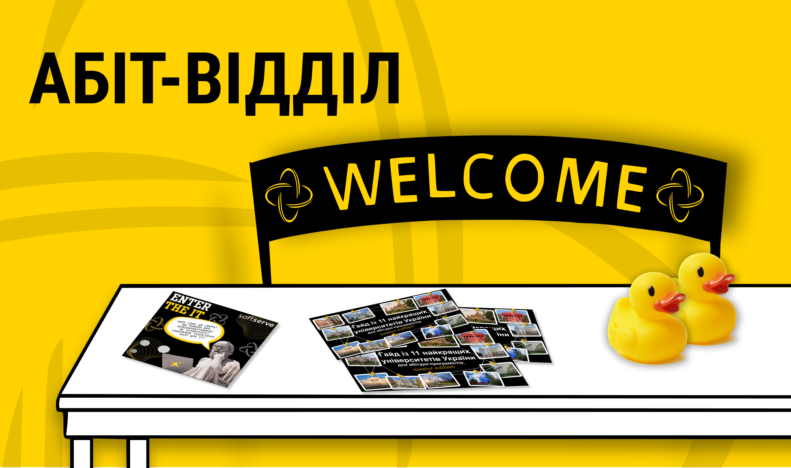
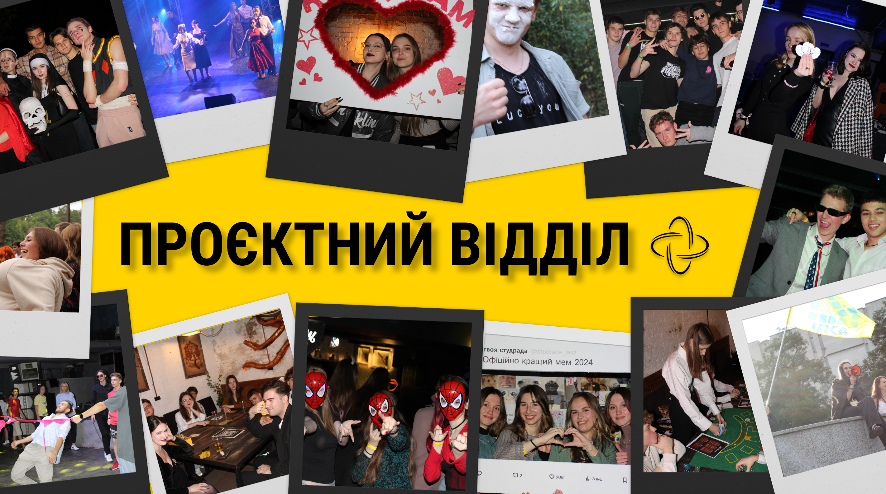
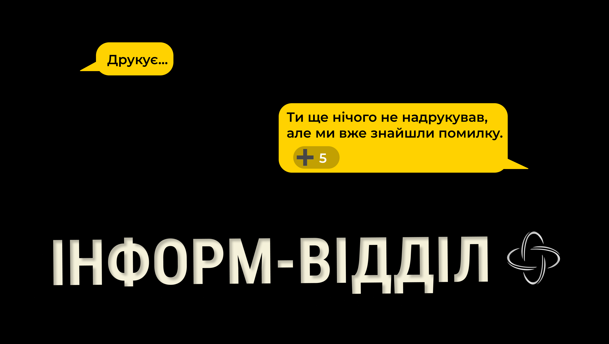
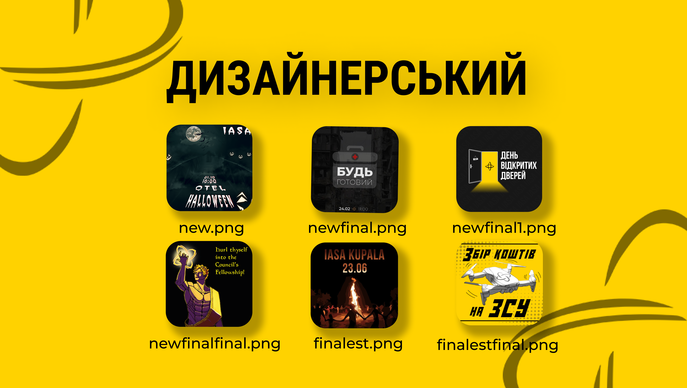
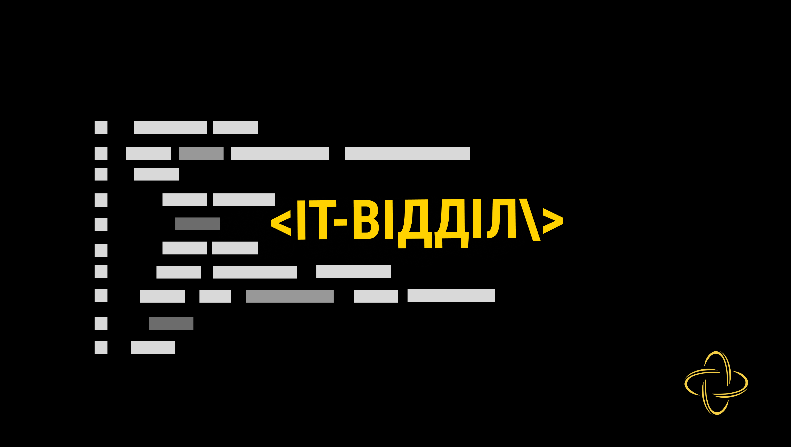
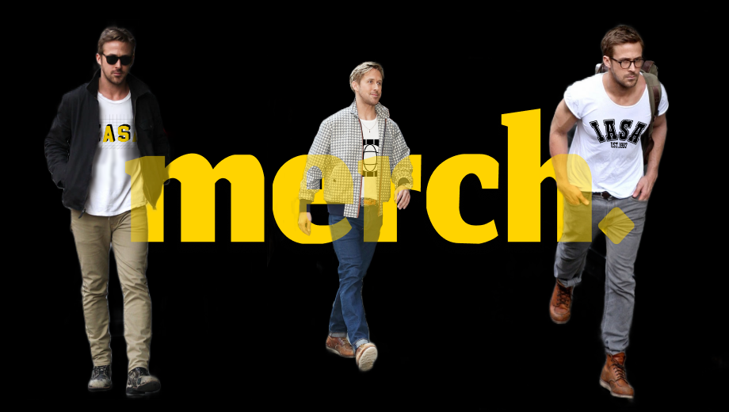

Ми будуємо Студраду, в центрі якої ти. Де кожен голос має вагу, де з будь-якою проблемою допоможуть, а після пар на тебе чекають івенти, а не порожня кімната.

І все це роблять звичайні студенти: ті, хто пише тексти, малює постери, програмує ботів і монтує відео. Бо інститут — це не корпус, а люди, і тут є місце для кожного.

Ми відкриваємо [донабір до Студради ІПСА](https://docs.google.com/forms/d/e/1FAIpQLScRFOo5geYZy_y8A6fihvmaJWEI7bknEkVkrhBzpRDpZEAZDg/viewform). Нижче розповідаємо, чим займається кожен відділ і кого в нього шукаємо. 

<!--truncate-->

---

## Абіт-відділ

Це перші люди, з якими майбутній студент знайомиться ще до вступу. Вони відповідають на запитання абітурієнтів і батьків у чатах, пишуть для нашого сайту статті на важливі для вступників теми та організовують заходи: День відкритих дверей, День ІПСАшника, Enter the IT. Якщо абітурієнт застряг між спеціальностями чи інститутами, абіт-відділ допоможе розібратися швидше, ніж він встигне загуглити «куди вступати».

**Кого шукаємо:** комунікабельних людей, які вміють пояснювати складне простими словами, мають терпіння і не губляться в стресі.

---

## Освітній відділ

Тут роблять навчання в ІПСА зручнішим і зрозумілішим. Відділ має три напрямки:

- **IASAedu** готує освітні пости й організовує лекції від ІТ-фахівців, розповідає про стажування, онлайн-курси та підготовку до співбесід.
- **КЯО (контроль якості освіти)** відповідає на звернення студентів щодо навчального процесу. Раз на два тижні в рубриці #Edu_Academic він простою мовою пояснює важливі правила й положення.
- **IASA Analytics** щосеместру проводить опитування з усіх предметів і за результатами готує статті для сайту Студради.

**Кого шукаємо:**

- для IASAedu: креативних і грамотних людей, які генерують ідеї для дописів;
- для IASA Analytics: тих, хто має базові навички аналітики та програмування і розуміє графічні фреймворки;
- для КЯО: ініціативних і дипломатичних людей, які готові знаходити спільну мову з викладачами й добре знають Положення про організацію освітнього процесу.

---

## Проєктний відділ

Саме ці люди створюють студентське життя поза лекціями. За рік вони організовують багато заходів, і перші чотири з них спеціально для першокурсників. Геловін, тематичні вечірки, благодійні ініціативи: кожен івент вони роблять «під ключ», від ідеї до реалізації.

**Кого шукаємо:** тих, хто вміє планувати час, працювати в команді, не панікує під тиском і знаходить вихід із будь-якої ситуації.

---

## Інформ відділ

Це голос Студради. Інформ-відділ веде текстовий контент для Telegram та Instagram, пише статті й готує інтерв'ю зі студентами та викладачами. Він також перевіряє й редагує тексти інших відділів, стежить, щоб кожна кома стояла на місці, а в публікаціях не було нічого недоречного. Це наш контроль якості, який не дасть нам зганьбитися.

**Кого шукаємо:** креативних людей з бездоганною українською, які спокійно сприймають критику та правки.

---

## Дизайнерський відділ

Жоден захід на факультеті не обходиться без дизайнерів. Вони відповідають за весь візуальний образ Студради: постери й афіші, аватарки для чатів, банери, ілюстрації. Усе, що ти бачиш раніше, ніж прочитаєш хоч слово. Вони працюють швидко й точно, і навіть найвибагливіші замовники лишаються задоволеними (навіть якщо за годину до дедлайну надіслали нескінченний список правок).

**Кого шукаємо:** тих, хто працює у Figma, Photoshop чи Illustrator, відчуває композицію, типографіку й колір, уміє працювати з ТЗ.

---

## IT-відділ

Без IT-відділу Студрада не працювала б. Він відповідає за автоматизацію та підтримує Telegram-ботів, зокрема IASA Bot, який допомагає студентам з організацією навчання (і навіть карає за абревіатурні злочини). Також IT-відділ розробив сайт Студради, де публікуються статті, корисні для абітурієнтів.

**Кого шукаємо:** тих, хто любить програмувати і хоче робити реальні продукти, якими щодня користуються сотні студентів.

---

## Відділ зовнішніх зв'язків

Це відділ, який шукає для Студради нові можливості. Він веде переговори з ІТ-компаніями та спонсорами, будує партнерства з іншими студрадами КПІ й шукає корисні зв'язки для розвитку спільноти.

**Кого шукаємо:** комунікабельних людей, які вміють вести ділове листування та переговори, переконувати й не лякаються відмов.

---

## Мерч-відділ

Це ті, завдяки кому в ІПСА хочеться ходити в рідному одязі. Відділ придумує дизайни футболок і світшотів, спілкується з постачальниками, обробляє замовлення та веде соцмережі магазину. А з запальничкою «Я системний аналітик» ти точно станеш найпопулярнішим студентом на потоці.

**Кого шукаємо:**

- дизайнерів (знання Figma буде плюсом);
- тих, хто готовий обробляти замовлення: оперативних і відповідальних;
- SMM-щиків для соцмереж магазину;
- людей, які люблять брейнштормити, бо нові дизайни узгоджуються всією командою.

---

## Медіа-відділ

Якби Сократа попросили описати цей відділ п'ятьма словами, він би сказав: «Коли будуть фотки з івентів?» Якщо без жартів, медіавідділ ловить найяскравіші моменти факультетських подій, наповнює Instagram фото й монтує динамічні відео та тизери.

**Кого шукаємо:** тих, хто вміє працювати з камерою, обробляти фото, монтувати відео та бачить ідеальний ракурс там, де інші його не помічають.

---

## TikTok-відділ

Завдяки цим людям Студрада в очах абітурієнтів не тільки серйозна, а й смішна. Вони ведуть наш TikTok, де замість нудних фактів веселі відео, і показують, що ІПСА — це не лише про навчання, а й про креатив.

**Кого шукаємо:** харизматичних і творчих людей, які вміють монтувати на телефоні й тримають руку на пульсі трендів.

---

## Твоє місце тут

Інститут — це не корпус, а люди. У Студраді ти зустрінеш тих, хто разом із тобою перетворює студентські роки на історію, яку не соромно згадувати. Не обов'язково мати досвід: головне, щоб тобі було цікаво й хотілося щось робити.

Обирай відділ, у якому відчуваєш, що це твоє, і подавай [заявку](https://docs.google.com/forms/d/e/1FAIpQLScRFOo5geYZy_y8A6fihvmaJWEI7bknEkVkrhBzpRDpZEAZDg/viewform).